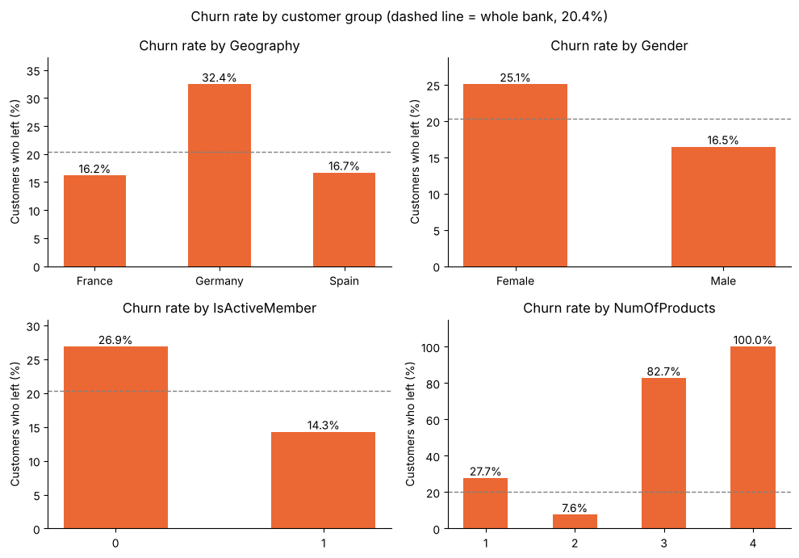

# Why do bank customers leave?

Group project for the course RM402E Statistics & Data Analysis at Rennes School of Business (2026).

## About the project

We study the churn of 10,000 customers of a European retail bank present in France, Germany and Spain. We describe the customers who leave, we test if the differences with the customers who stay are statistically significant, and we build models to predict which customers are likely to leave.

## Files

| File | Content |
|---|---|
| `Bank_Churn_Group_Project.ipynb` | notebook with the code, the results and our comments |
| `Churn_Modelling.csv` | dataset (10,000 customers, 14 columns) |

The dataset is the [Churn Modelling dataset from Kaggle](https://www.kaggle.com/datasets/shrutimechlearn/churn-modelling).

## Technologies used

-  ⁠*Python* for all the analysis
-  ⁠*Google Colab* to write and run the notebook
-  ⁠*pandas* and *numpy* to load, clean and prepare the data
-  ⁠*scipy* for the probabilities, confidence intervals and hypothesis tests
-  ⁠*scikit-learn* for the logistic regression and the random forest
-  *matplotlib* and *seaborn* for the charts
-  *Kaggle* for the dataset
-  *GitHub* to store and share the project

## Methods

- Data cleaning and descriptive statistics
- Exploratory data analysis
- Probabilities, normality tests and Central Limit Theorem
- Confidence intervals for a mean and for a proportion
- Hypothesis tests (Mann-Whitney, chi-square, Kruskal-Wallis, Spearman correlation)
- Logistic regression and random forest

## Main results

- 20.37% of the customers left the bank.
- Age is the main factor. 44.65% of the customers older than 50 left.
- The churn rate in Germany (32.4%) is twice the rate in France (16.2%) and Spain (16.7%).
- Inactive members, women and customers with 3 or 4 products leave more often.
- Salary, tenure and credit card are not linked to churn.
- The random forest reaches an accuracy of 86% on the test set and finds 46% of the leavers.

  
  

  

## Conclusion

One customer in five left the bank. The typical leaver is older, more often a woman, more often German, less active, and holds either a single product or more than two. Our hypothesis tests confirm that age, balance, country, gender, activity and number of products are significantly linked to churn, while salary, tenure and credit card are not.

Churn can be partly predicted. The random forest is right for 86% of the customers and age is the main predictor in every model.
We recommend the bank to focus first on customers older than 50, to investigate why German customers leave twice as often, to reactivate inactive members, and to look closely at customers with 3 or 4 products, since almost all of them left.

Our results show associations and not causes, and the dataset is a snapshot, so we could not study churn over time.

## How to run the notebook

1. Open `Bank_Churn_Group_Project.ipynb` in Google Colab.
2. Put `Churn_Modelling.csv` in the same folder. In Colab, upload it in the Files panel or use the two commented lines of the second code cell.
3. Run all the cells.

## Team members

Click on each name to open the member's LinkedIn profile.

<ul>
  <li><a href="https://www.linkedin.com/in/aya-ittas">Aya ITTAS</a></li>
  <li><a href="https://www.linkedin.com/in/mrdouah">Mohamed Amine DOUAH</a></li>
  <li><a href="https://www.linkedin.com/in/givi-kvaratskheliya-14a350342">Givi KVARATSKHELIYA</a></li>
  <li><a href="https://www.linkedin.com/in/eva-bagaeva-972464450">Eva BAGAEVA</a></li>
  <li><a href="https://www.linkedin.com/in/yashwanth-chamanahalli-nagesh-698517342">Yashwanth Chamanahalli NAGESH</a></li>
  <li><a href="https://www.linkedin.com/in/darryl-krystale-mehohi-514a98225">Darryl Krystale MEHOHI</a></li>
</ul>
